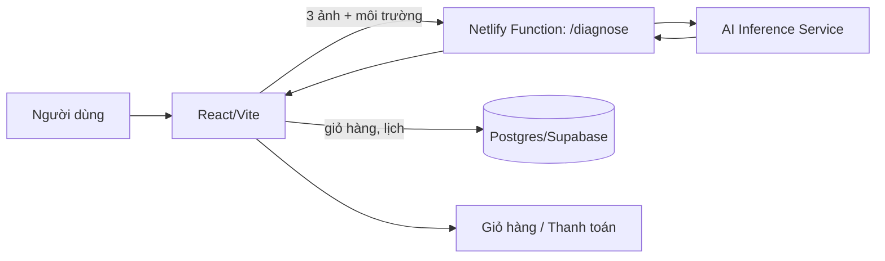

# GreenSeed - Kiến trúc kỹ thuật (bản triển khai thật)

Bản web hiện tại là frontend tĩnh, mô phỏng AI và lưu dữ liệu bằng LocalStorage. Tài liệu này mô tả cách nối với backend thật.

## Luồng dữ liệu

API key AI chỉ để trong biến môi trường của Netlify Function, không đặt trong frontend.

## Schema (SQL rút gọn)
```sql
CREATE TABLE plant_disease(id serial PRIMARY KEY, name_vi text, name_sci text, category text, symptoms text, root_cause text, organic_method text, chemical_method text);
CREATE TABLE disease_product(disease_id int REFERENCES plant_disease, sku text, milestone text);
CREATE TABLE recovery_step(disease_id int REFERENCES plant_disease, day int, task text);
CREATE TABLE garden_setup(id serial PRIMARY KEY, user_id uuid, photo_url text, area_m2 numeric, light text, tier text, budget numeric, items jsonb);
CREATE TABLE blog_category(id serial PRIMARY KEY, slug text UNIQUE, name text);
CREATE TABLE blog_post(id serial PRIMARY KEY, category_id int REFERENCES blog_category, title text, body_md text, tags text[], cover text);
CREATE TABLE user_timeline(id serial PRIMARY KEY, user_id uuid, product_sku text, start_date date, scenario text, done jsonb, xp int DEFAULT 0);
```

## Pseudocode
```
diagnose(images[3], env):
  require len(images) >= 3
  feats = [vision_model(i) for i in images]
  probs = classifier(fuse(feats), env)
  d = argmax(probs); return {disease, accuracy=probs[d], products=lookup(d), schedule=recovery(d)}

budget(area, tier):
  total = area * RATE[tier]            # Starter/Optimal/Premium
  alloc = {seeds:.6, soil:.2, pots:.1, tools:.1} * total
  qty = clamp(round(alloc / (n_items * price)), 1, 20) for each item

timeline(plant, start, scenario):
  for day in 1..harvest: tasks = water(stage(day)) + fertilize(day) + quest(day) + folk_tip(day)
  danger_alerts at days 3, 15, 45; export tasks as .ics with 12h alarm
```
